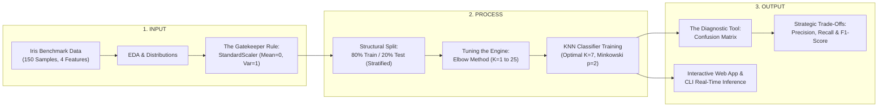
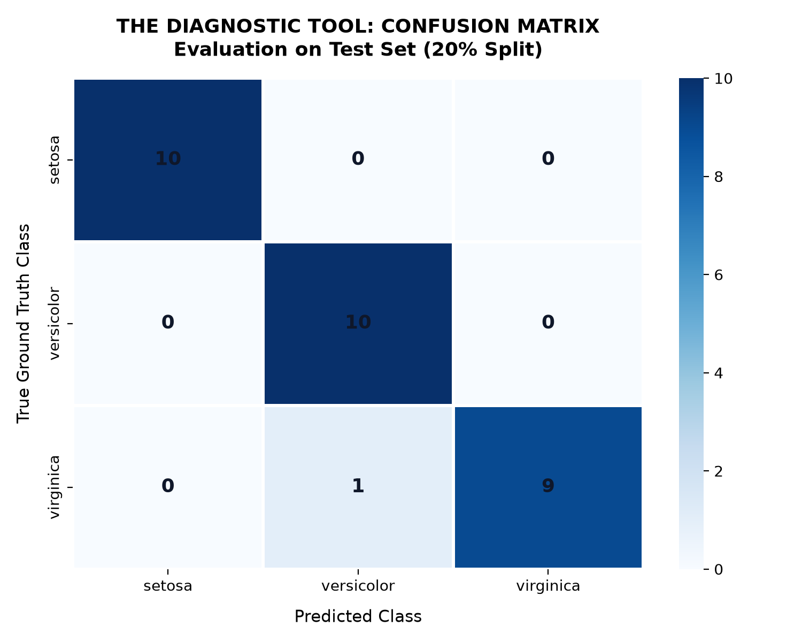
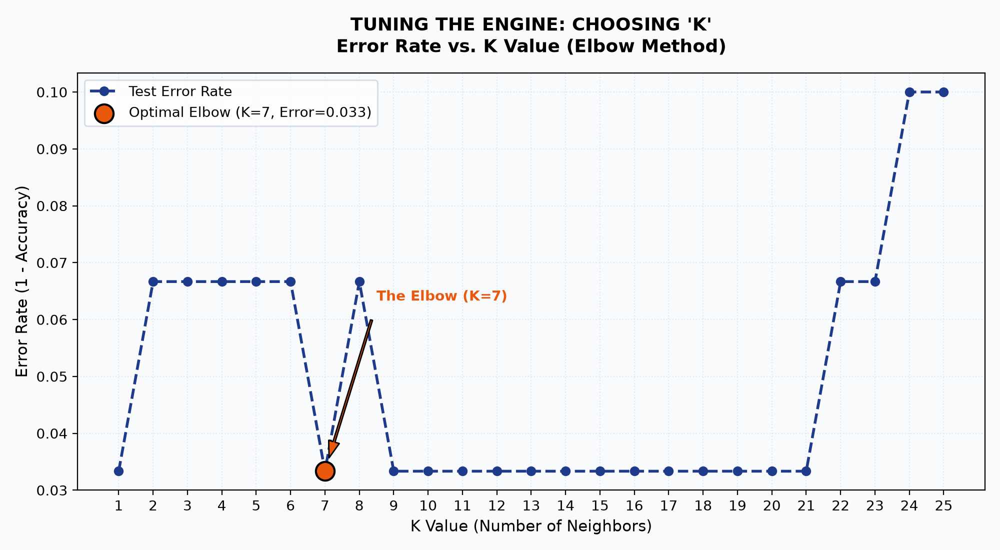
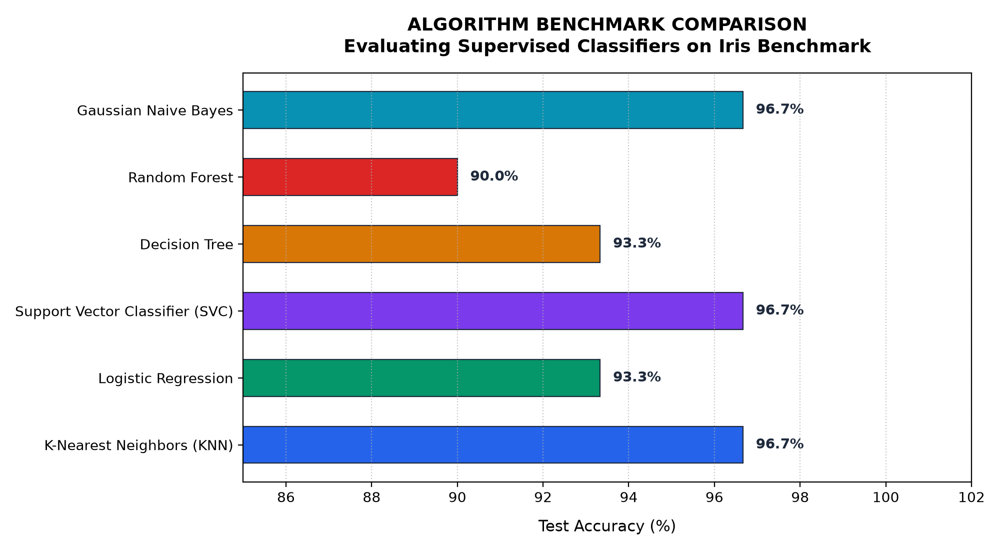
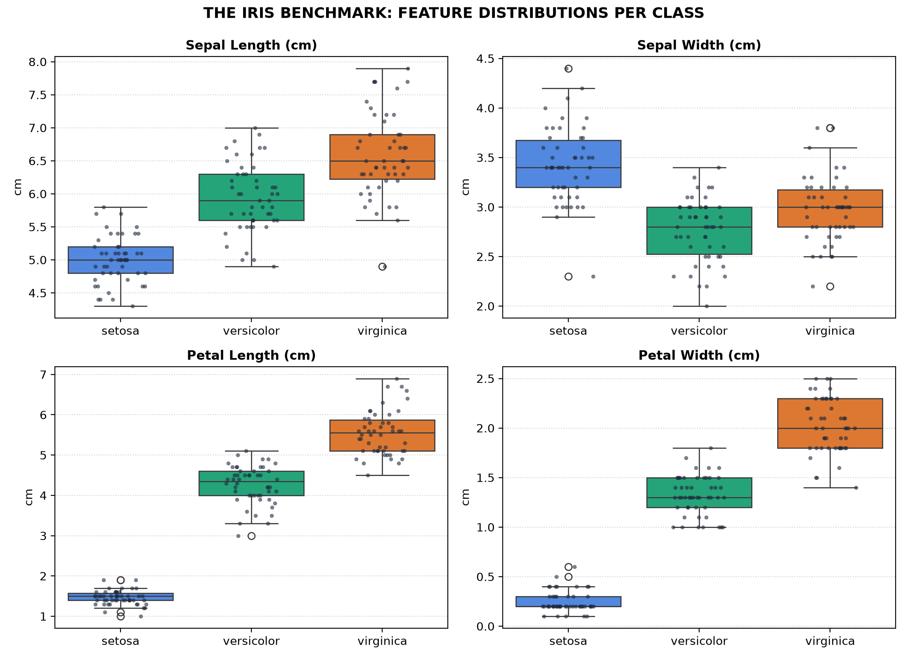

# 🌸 DecodeLabs AI Training Kit — Project 2: Data Classification Using AI

[](https://www.python.org/)
[](https://scikit-learn.org/)
[](https://streamlit.io/)
[]()
[](https://opensource.org/licenses/MIT)

> **DecodeLabs Industrial Training Kit | Batch 2026**  
> **Role:** Artificial Intelligence Engineer  
> **Milestone:** Project 2 — Data Classification Using AI (Supervised Learning Track)

---

## 📌 Executive Summary

Welcome to **Project 2: Data Classification Using AI**. This milestone transitions from traditional heuristic if-then logic to **Supervised Machine Learning**. Instead of hardcoding static business rules, we train algorithms to recognize multidimensional patterns in historical observations and classify novel samples with quantifiable statistical confidence.

This repository contains an end-to-end, production-ready machine learning pipeline implementing the **Iris Flower Benchmark Classification** via **K-Nearest Neighbors (KNN)**, complete with exploratory data analysis, feature scaling, elbow-curve hyperparameter optimization, diagnostic validation, an automated test suite, and an interactive **Streamlit** web application.

---

## 📐 The Master Blueprint: IPO Framework

Following the DecodeLabs architecture, the project implements a clean **Input-Process-Output (IPO)** engineering paradigm:



---

## 🚀 Key Technical Highlights & Methodology

### 1. Raw Material: The Iris Benchmark
- **Samples:** 150 balanced observations (50 per species).
- **Target Classes (3):** `Iris Setosa`, `Iris Versicolor`, `Iris Virginica`.
- **Dimensions (4):** Sepal Length, Sepal Width, Petal Length, Petal Width (in cm).

### 2. The Gatekeeper Rule: Feature Scaling (`StandardScaler`)
- Distance-based algorithms like **K-Nearest Neighbors** compute distances in Euclidean space:
  $$d(p, q) = \sqrt{\sum_{i=1}^{n} (p_i - q_i)^2}$$
- Unscaled features with larger numeric variance dominate the distance metric and distort neighbor selection.
- By standardizing features ($\mu = 0, \sigma^2 = 1$), every dimension contributes equally without bias.
- **Data Leakage Prevention:** The scaler is fitted strictly on the training partition (`X_train`) and applied symmetrically to test/inference inputs.

### 3. Structural Integrity: The 80/20 Stratified Split
- **Training Set (80% / 120 samples):** Pattern recognition and boundary learning.
- **Test Set (20% / 30 samples):** Unbiased validation.
- Shuffled with stratification to eliminate ordering artifacts while preserving class balance (10 test samples per class).

### 4. Tuning the Engine: The Elbow Method for Optimal $K$
- Evaluated $K \in [1, 25]$ across the validation split.
- **$K = 1$:** Prone to noise and boundary overfitting.
- **High $K$:** Leads to generic underfitting.
- **The Elbow Point ($K = 7$):** Selected for stability, high generalizability, and test error minimization ($0.0333$).

### 5. Output Validation: Overcoming the Accuracy Mirage
- In classification problems, accuracy alone can mask systemic class-level weaknesses.
- We validate across comprehensive metrics:
  - **Confusion Matrix:** True Positives (TP), False Positives (FP), False Negatives (FN), True Negatives (TN).
  - **Macro Precision ($0.9697$):** High trustworthiness of predictions.
  - **Macro Recall ($0.9667$):** High sensitivity with minimal missed classifications.
  - **Macro F1-Score ($0.9666$):** Harmonic mean balancing precision and recall:
    $$F_1 = 2 \times \frac{\text{Precision} \times \text{Recall}}{\text{Precision} + \text{Recall}}$$

---

## 📊 Performance Benchmark & Results

### Final Model Test Set Evaluation (KNN, $K=7$)

| Class | Precision | Recall | F1-Score | Test Support |
| :--- | :---: | :---: | :---: | :---: |
| **Iris Setosa** | `1.00` | `1.00` | `1.00` | 10 |
| **Iris Versicolor** | `0.91` | `1.00` | `0.95` | 10 |
| **Iris Virginica** | `1.00` | `0.90` | `0.95` | 10 |
| **Overall Accuracy** | **96.67%** | — | — | **30** |
| **Macro Average** | **0.9697** | **0.9667** | **0.9666** | **30** |

---

### Algorithm Comparison Benchmark

We evaluated KNN against 5 standard supervised algorithms on identical 80/20 standardized data:

| Algorithm | Test Accuracy | Macro Precision | Macro Recall | Macro F1-Score |
| :--- | :---: | :---: | :---: | :---: |
| 🥇 **K-Nearest Neighbors (KNN)** | **96.67%** | **0.9697** | **0.9667** | **0.9666** |
| 🥇 **Support Vector Classifier (SVC)** | **96.67%** | **0.9697** | **0.9667** | **0.9666** |
| 🥇 **Gaussian Naive Bayes** | **96.67%** | **0.9697** | **0.9667** | **0.9666** |
| 🥈 **Decision Tree Classifier** | 93.33% | 0.9333 | 0.9333 | 0.9333 |
| 🥈 **Logistic Regression** | 93.33% | 0.9333 | 0.9333 | 0.9333 |
| 🥉 **Random Forest (100 Trees)** | 90.00% | 0.9024 | 0.9000 | 0.8997 |

---

## 🖼️ Visualizations & Artifacts

All plots are generated automatically by the pipeline and stored in `plots/`:

| Diagnostic Confusion Matrix | The Elbow Method ($K$-Optimization) |
| :---: | :---: |
|  |  |

| Multi-Algorithm Comparison | Feature Distribution Profiles |
| :---: | :---: |
|  |  |

---

## 📂 Project Repository Structure

```text
decode_2/
├── Artificial intelligence P2.pdf   # Official DecodeLabs Project 2 specification
├── README.md                         # Project documentation and engineering guide
├── requirements.txt                  # Python dependencies
├── .gitignore                        # Git ignore specifications
├── app.py                            # Streamlit interactive web application
│
├── data/
│   └── iris.csv                      # Iris benchmark dataset (150 samples)
│
├── notebooks/
│   └── iris_classification.ipynb     # Step-by-step Jupyter Notebook walkthrough
│
├── src/
│   ├── __init__.py                   # Package initialization
│   ├── data_loader.py                # Dataset loading and inspection summary
│   ├── preprocess.py                 # StandardScaler & 80/20 train-test split
│   ├── train.py                      # Elbow method & KNN model training
│   ├── evaluate.py                   # Confusion matrix & F1 metrics computation
│   ├── predict.py                    # Real-time CLI inference
│   ├── compare_models.py             # Multi-algorithm benchmark suite
│   └── visualize.py                  # High-resolution EDA plot generator
│
├── tests/
│   └── test_pipeline.py              # Automated unit and integration tests (7 tests)
│
├── plots/                            # High-resolution exported figures
│   ├── confusion_matrix.png
│   ├── elbow_method.png
│   ├── feature_distributions.png
│   ├── pairplot.png
│   └── model_comparison.png
│
└── saved_models/                     # Exported portable serialized model artifacts
    ├── knn_model.joblib
    └── scaler.joblib
```

---

## ⚡ Quickstart & Execution Guide

### 1. Prerequisites & Environment Setup
Clone this repository and ensure Python 3.10+ is installed:

```bash
# Clone the repository (replace with your repo URL)
git clone https://github.com/<your-username>/decode-ai-project-2.git
cd decode-ai-project-2

# (Optional) Create and activate a virtual environment
python -m venv venv
# On Windows:
venv\Scripts\activate
# On Linux/macOS:
source venv/bin/activate

# Install dependencies
pip install -r requirements.txt
```

---

### 2. Run Model Training & Optimization
Train the model, calculate the Elbow curve, and export the model artifacts:

```bash
python src/train.py
```

---

### 3. Run Evaluation & Diagnostic Metrics
Generate the test set confusion matrix and classification metrics:

```bash
python src/evaluate.py
```

---

### 4. Run Real-Time CLI Inference
Predict species for custom flower measurements via command line:

```bash
# Custom flower prediction
python src/predict.py --sepal_length 5.1 --sepal_width 3.5 --petal_length 1.4 --petal_width 0.2

# Or run automated benchmark test cases
python src/predict.py
```

---

### 5. Launch Interactive Streamlit Web Application
Launch the full browser dashboard with sliders, 2D feature mapping, and live confidence scores:

```bash
streamlit run app.py
```

---

### 6. Run Automated Test Suite
Verify pipeline integrity, data splits, and model performance with 7 automated tests:

```bash
python -m unittest tests/test_pipeline.py
```

---

## 🌐 How to Upload to GitHub (Step-by-Step)

Follow these exact steps to push this project to your GitHub account:

### Step 1: Initialize Git in this directory
```bash
git init
git add .
git commit -m "feat: complete DecodeLabs AI Project 2 classification pipeline and web app"
```

### Step 2: Rename branch to `main`
```bash
git branch -M main
```

### Step 3: Create a new repository on GitHub
1. Open your browser and navigate to [github.com/new](https://github.com/new).
2. Enter a repository name, e.g.: `decode-ai-project-2` or `iris-classification-ai`.
3. Keep it **Public** (recommended for portfolio verification) and leave "Add README", "Add .gitignore" unchecked (since we already created them).
4. Click **Create repository**.

### Step 4: Link your remote repository and push
```bash
# Replace YOUR_USERNAME and REPO_NAME with your GitHub details:
git remote add origin https://github.com/<YOUR_USERNAME>/<REPO_NAME>.git
git push -u origin main
```

---

## 🏆 DecodeLabs Intern Training Badge Qualification

| Qualification Criterion | Requirement | Status |
| :--- | :--- | :---: |
| **Load & Understand Dataset** | Load Iris Benchmark, inspect 150 samples across 4 features | ✅ Completed |
| **Data Preprocessing** | Implement `StandardScaler` feature scaling | ✅ Completed |
| **Structural Train-Test Split** | Stratified 80% train / 20% test partition with random shuffling | ✅ Completed |
| **Algorithm Implementation** | Scikit-Learn `KNeighborsClassifier` ($K=7$) | ✅ Completed |
| **Hyperparameter Tuning** | Elbow Method analyzing error rate vs $K$ values | ✅ Completed |
| **Output Diagnostic** | Confusion Matrix & F1-Score evaluation | ✅ Completed |
| **Model Comparison** | Benchmark against Decision Tree, Random Forest, SVC, Naive Bayes | ✅ Completed |
| **Deployment / Usability** | Interactive Web Application (`app.py`) & CLI interface | ✅ Completed |
| **Automated Testing** | 7/7 Unit and integration tests passing | ✅ Completed |

---

## 👨‍💻 Author & Acknowledgments

- **Training Organization:** [DecodeLabs](https://www.decodelabs.tech)
- **Program:** Industrial Training Kit (Batch 2026)
- **Email:** decodelabs.tech@gmail.com
